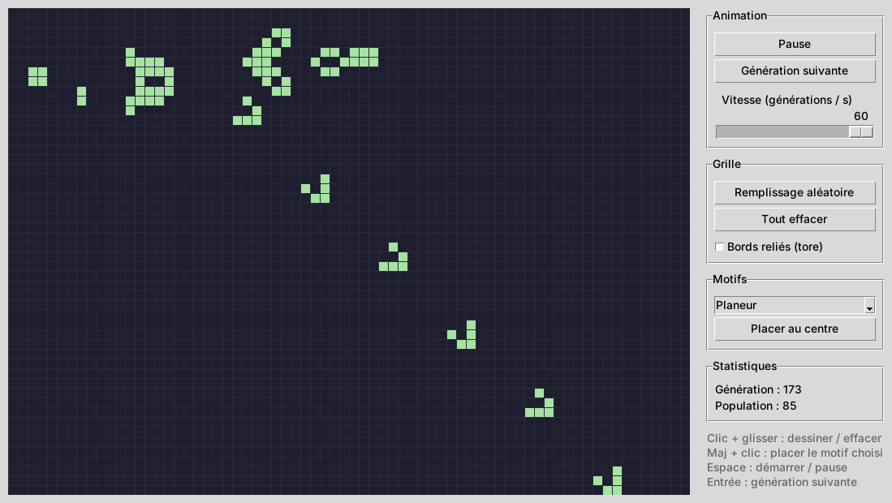

# Jeu de la vie de John Horton Conway — projet NSI

Automate cellulaire inventé par le mathématicien John Horton Conway en 1970,
programmé en Python avec des classes et un affichage graphique Tkinter.



## Les règles

La grille est composée de cellules vivantes ou mortes. Chaque cellule a 8 voisines.
À chaque génération, toutes les cellules évoluent **en même temps** :

- une cellule **morte** avec exactement **3** voisines vivantes **naît** ;
- une cellule **vivante** avec **2 ou 3** voisines vivantes **survit** ;
- dans tous les autres cas, la cellule **meurt** (isolement ou surpopulation).

## Lancer le programme

Aucune bibliothèque à installer : Tkinter est fourni avec Python (sous Linux,
il faut parfois installer le paquet `python3-tk`).

```bash
python main.py
```

Affichage dans le terminal, sans fenêtre :

```bash
python main.py --console
```

Lancer les tests :

```bash
python test_jeu_de_la_vie.py
```

## Commandes de la fenêtre

| Action | Effet |
|---|---|
| Clic + glisser | dessiner des cellules (ou les effacer si on part d'une cellule vivante) |
| Maj + clic | placer le motif choisi à l'endroit cliqué |
| Espace | démarrer / mettre en pause |
| Entrée | avancer d'une génération |
| Curseur « Vitesse » | de 1 à 60 générations par seconde |
| « Bords reliés (tore) » | ce qui sort d'un côté de la grille revient de l'autre |

Motifs disponibles : clignotant, crapaud, pulsar, planeur, vaisseau léger,
canon de Gosper, R-pentomino, gland.

## Organisation du code

| Fichier | Contenu |
|---|---|
| `cellule.py` | classe `Cellule` : son état, ses voisines, les règles de Conway |
| `grille.py` | classe `Grille` : le tableau de cellules et le passage à la génération suivante |
| `motifs.py` | dictionnaire `MOTIFS` des motifs célèbres |
| `affichage.py` | classe `FenetreJeu` : la fenêtre Tkinter et les interactions |
| `main.py` | programme principal |
| `test_jeu_de_la_vie.py` | tests (bloc stable, clignotant, planeur, canon…) |

### Pourquoi calculer en deux étapes ?

`Grille.generation_suivante()` demande d'abord à **toutes** les cellules de calculer
leur futur état (`calculer_etat_suivant`), puis seulement ensuite de l'appliquer
(`passer_a_l_etat_suivant`). Si l'on modifiait les cellules une par une, une cellule
verrait certaines voisines déjà dans la génération suivante, et le résultat serait faux.
