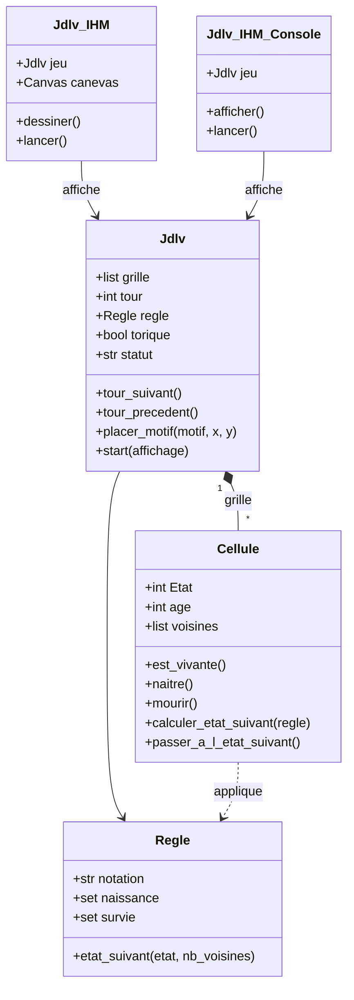

# Jeu de la vie — projet POO, Terminale NSI

Automate cellulaire inventé par le mathématicien John Horton Conway en 1970,
programmé en Python orienté objet, avec un affichage graphique Tkinter (Canvas)
et un affichage console.


## Les règles

Chaque cellule est vivante (`Etat = 1`) ou morte (`Etat = 0`) et a 8 voisines.
À chaque tour, toutes les cellules évoluent **en même temps** :

- une cellule **morte** avec exactement **3** voisines vivantes **naît** ;
- une cellule **vivante** avec **2 ou 3** voisines vivantes **survit** ;
- dans tous les autres cas, elle **meurt** (isolement ou surpopulation).

En notation « B/S » (*Birth / Survival*), cette règle s'écrit `B3/S23`.

## Lancer le programme

Rien à installer : Tkinter est fourni avec Python (sous Linux, il faut parfois
le paquet `python3-tk`).

```bash
python main.py
```

Au lancement, le programme détecte la machine (voir plus bas) et choisit la
taille du tableau. Pour imposer une taille (largeur puis hauteur) :

```bash
python main.py 220 140
```

Affichage dans le terminal (efface l'écran à chaque tour) :

```bash
python main.py --console
```

Lancer les tests (29 tests) :

```bash
python test_jeu_de_la_vie.py
```

On peut aussi les lancer avec pytest :

```bash
python -m pytest
```

**Version téléphone** : `web/jeu_de_la_vie.html` s'ouvre dans n'importe quel
navigateur, sur ordinateur ou sur téléphone, sans rien installer. Tkinter ne
fonctionne pas sur un téléphone, donc les classes Python y sont traduites en
JavaScript, avec les mêmes noms : `Cellule.Etat`, `Jdlv.grille`, `Jdlv.tour`,
`tour_suivant()`, `Jdlv_IHM`... On y dessine au doigt, et on y retrouve les
règles, les motifs, la détection des cycles et les fichiers RLE. Le damier va de
200 × 200 à 3 000 × 3 000 cases, avec zoom à deux doigts : pour tenir 9 millions
de cases sur un téléphone, les `Etat` y sont rangés dans un tableau d'octets
(`Uint8Array`) au lieu d'un objet `Cellule` par case.

Depuis un programme, on crée un jeu en instanciant `Jdlv` puis on le lance avec `start()` :

```python
from jdlv import Jdlv
from motifs import MOTIFS

jeu = Jdlv(70, 45, torique=True)       # tableau fini de 70 x 45 cellules
jeu.placer_motif(MOTIFS["Planeur"], 10, 10)   # ou : jeu.remplir_aleatoirement(0.25)
jeu.start()                             # ou : jeu.start("console")
```

## Ce que demande le sujet, et où le trouver

| Exigence du sujet | Dans le code |
|---|---|
| Classe `Cellule` avec un attribut `Etat` entier (0 morte, 1 vivante) | `cellule.py` : `Cellule.Etat` |
| Classe `Jdlv` avec un tableau 2D (liste de listes) de `Cellule` | `jdlv.py` : `Jdlv.grille[y][x]` |
| Attribut entier `tour`, 0 au départ | `Jdlv.tour` |
| Configuration aléatoire ou motifs particuliers | `remplir_aleatoirement()`, `placer_motif()`, `charger_motif()` |
| Lancer le jeu avec une méthode `start()` | `Jdlv.start("tkinter")` ou `Jdlv.start("console")` |
| Classe `Jdlv_IHM` qui gère l'affichage (console ou Tkinter/Canvas) | `jdlv_ihm.py` : `Jdlv_IHM` (Tkinter + Canvas) et `jdlv_ihm_console.py` : `Jdlv_IHM_Console` |
| Tests | `test_jeu_de_la_vie.py` (voir plus bas) |

## Fonctionnalités (originalité)

| Fonctionnalité | Comment l'utiliser |
|---|---|
| Animation réglable (1 à 60 tours/s), tour par tour | boutons, **Espace** (lecture/pause), **Entrée** (tour suivant) |
| **Retour arrière** jusqu'à 500 tours | bouton « Tour précédent » ou touche **Retour arrière** |
| Dessin à la souris | clic + glisser (efface si on part d'une cellule vivante) |
| 11 motifs célèbres | liste « Motifs », **Maj + clic** pour le placer sous la souris |
| **Couleur selon l'âge** des cellules | jaune = vient de naître ... mauve = vivante depuis 20 tours ou plus |
| **8 règles** (Conway, HighLife, Seeds, Day & Night, Réplicateur...) ou règle tapée au clavier | liste « Règle (B/S) », taper par ex. `B36/S23` puis Entrée |
| **Détection automatique** : extinction, stable, cycle de période *p* | affichée dans « Statistiques », pause automatique (désactivable) |
| **Courbe de population** | sous le tableau |
| Bords reliés (tore) ou tableau fermé | case « Bords reliés (tore) » |
| **Taille du tableau réglable** : tailles proposées selon l'écran et la vitesse de la machine (jusqu'à 576 × 334 sur un PC rapide en 1920 × 1080), ou au choix | cadre « Tableau » : liste ou largeur × hauteur puis « Appliquer » ; les cellules vivantes sont gardées au centre |
| **Adaptation au matériel** | menu Aide › Matériel détecté (voir plus bas) |
| **Import / export RLE**, le format des passionnés (LifeWiki, Golly) | menu Fichier, **Ctrl+O** / **Ctrl+S** ; exemples dans `motifs_rle/` |
| Affichage console | `python main.py --console` |

Idée à tester : ouvrir `motifs_rle/replicateur_highlife.rle`. La règle HighLife
(B36/S23) est lue dans le fichier, et le motif se recopie tous les 12 tours.

## Organisation du code



| Fichier | Contenu |
|---|---|
| `cellule.py` | classe `Cellule` : état, âge, voisines, calcul de l'état suivant |
| `regle.py` | classe `Regle` (notation B/S) et dictionnaire `REGLES` des règles célèbres |
| `jdlv.py` | classe `Jdlv` : tableau de cellules, tours, historique, détection des cycles, `start()` |
| `jdlv_ihm.py` | classe `Jdlv_IHM` : fenêtre Tkinter, Canvas, souris, clavier, courbe |
| `jdlv_ihm_console.py` | classe `Jdlv_IHM_Console` : affichage dans le terminal |
| `motifs.py` | dictionnaire `MOTIFS` des motifs célèbres |
| `rle.py` | lecture / écriture des fichiers de motifs `.rle` |
| `materiel.py` | classe `Materiel` : détecte la machine et en déduit les réglages |
| `main.py` | programme principal |
| `web/jeu_de_la_vie.html` | version web jouable au doigt (mêmes classes, traduites en JavaScript) |
| `test_jeu_de_la_vie.py` | les tests |

**Séparation calcul / affichage** : `Cellule`, `Regle` et `Jdlv` ne savent rien de
l'affichage. Les deux classes d'affichage ont les mêmes méthodes (`afficher` ou
`dessiner`, puis `lancer`), donc `Jdlv.start()` peut utiliser l'une ou l'autre.

## Les tests

`test_jeu_de_la_vie.py` contient 29 tests, regroupés par thème :

| Thème | Ce qui est vérifié |
|---|---|
| Conformité au sujet | `Etat` entier, `grille` liste de listes de `Cellule`, `tour` à 0, `start()` |
| Entrées invalides | état 2, tableau trop petit, densité 1,5, règle `B9/S23`, fichier RLE abîmé |
| Règles | les 18 cas (morte/vivante × 0 à 8 voisines), HighLife, Seeds, âge des cellules |
| Voisinage, bords et taille | 3 voisines dans un coin, 5 sur un bord, 8 au milieu ou sur un tore ; agrandir ou réduire le tableau garde le dessin au centre |
| Motifs connus | bloc stable, clignotant (période 2), planeur (1 case en diagonale en 4 tours), vaisseau léger (2 cases en 4 tours), pulsar (48 cellules, période 3), pentadécathlon (période 15), canon de Gosper (+1 planeur tous les 30 tours), diehard (disparaît au tour 130) |
| Implémentation de référence | sur des tableaux aléatoires, le résultat est comparé, tour après tour, à un calcul indépendant écrit autrement ; une partie de 250 tours, avec un dessin au milieu, vérifie que l'optimisation des cellules actives ne change rien |
| Matériel | profil reconnu, tailles proposées qui tiennent dans l'écran, mémoire de l'historique bornée |
| Historique et cycles | retour arrière sur 30 tours, détection extinction / stable / cycle |
| Format RLE | le canon de Gosper publié sur LifeWiki est identique à notre motif ; aller-retour écriture → lecture |
| Affichage console | le motif est affiché et la simulation s'arrête d'elle-même |
| Doctests | les exemples `>>>` des docstrings (`Regle`, `Cellule`, `rle`, `motifs`) donnent bien le résultat annoncé |

## Adaptation au matériel

Au lancement, la classe `Materiel` (`materiel.py`) regarde :

- le système, le nombre de cœurs du processeur et la mémoire vive ;
- la taille de l'écran (lue par Tkinter) ;
- la **vitesse réelle du programme** : elle fait tourner un petit jeu de
  60 × 60 cases pendant un quart de seconde et compte les cellules calculées par
  seconde. C'est la mesure la plus fiable, car elle dépend à la fois du
  processeur et de la version de Python.

Elle en déduit un profil (économe, équilibré, puissant) et des réglages :

| Réglage | Calcul |
|---|---|
| Place du tableau à l'écran | environ 60 % de l'écran |
| Tailles proposées | cases de 12, 7, 4, 2 ou 1 pixels dans cette place, sans celles qui feraient moins de 2 tours par seconde |
| Vitesse annoncée | cellules par seconde ÷ (cases × (1 + coût du dessin)) ; le dessin coûte environ 8 fois le calcul avec des rectangles et 2,5 fois avec une image |
| Taille au lancement | cases de 7 px (12 px sur une machine économe) |
| Mémoire du retour arrière | 2 % de la mémoire vive, entre 16 et 256 Mo |
| Console | le tableau prend la taille du terminal |

Le résumé s'affiche dans le menu Aide › Matériel détecté.

## Optimisations

- **Ne recalculer que les cellules actives.** L'état futur d'une cellule ne
  dépend que d'elle et de ses 8 voisines : si aucune des neuf n'a changé, elle
  ne change pas. À chaque tour, on ne recalcule que les cellules qui viennent
  de changer et leurs voisines. Après 300 tours d'une soupe aléatoire de
  220 × 140, seules 4 % des cases changent encore : un tour passe de 20 ms à
  5 ms.
- **`__slots__` dans `Cellule`** : chaque objet prend deux fois moins de
  mémoire et l'accès à ses attributs est plus rapide.
- **Laisser travailler le C** : `bytes(map(attrgetter("Etat"), cellules))`
  calcule la signature sans boucle Python, et cette signature n'est calculée
  qu'une fois par tour (au lieu de deux).
- **Dessin** : les couleurs sont lues dans des tables avec `map()`, et une
  ligne du tableau qui n'a pas changé n'est pas redessinée.

## Difficultés rencontrées (et solutions)

- **Mise à jour en deux étapes.** Si on modifie les cellules pendant le parcours,
  les voisines déjà modifiées faussent le calcul. Chaque cellule calcule d'abord
  `etat_suivant`, puis toutes l'appliquent.
- **Les bords.** Une cellule de bord a moins de 8 voisines. On calcule une fois
  pour toutes la liste des voisines de chaque cellule ; en mode tore, on utilise
  le modulo (`%`) pour relier les bords.
- **Animation sans bloquer la fenêtre.** Une boucle `while` empêche Tkinter de
  réagir aux clics. On utilise `fenetre.after(délai, fonction)`, qui rappelle la
  fonction plus tard et rend la main à Tkinter entre deux tours.
- **Rapidité de l'affichage.** On crée les 3 150 rectangles une seule fois, puis
  on ne recolore que les cases qui ont changé. Pour les grands tableaux (cases de
  moins de 5 pixels), des dizaines de milliers de rectangles ralentissent
  Tkinter : on dessine alors une seule image (`PhotoImage`, un pixel par case),
  agrandie avec `zoom()`. Le calcul reste celui des objets `Cellule` : environ
  0,2 s par tour pour 440 × 280 = 123 200 cases. C'est la limite d'une cellule
  objet en Python ; la version web, avec un tableau d'octets, calcule 2 000 × 2 000
  cases en environ 50 ms.
- **Détecter qu'il ne se passe plus rien.** Le tableau est fini : il n'a qu'un
  nombre fini d'états possibles, donc la simulation finit toujours par repasser
  par un état déjà vu. On range chaque état dans un dictionnaire
  `signature → tour` : quand un état revient, la période est la différence
  des deux tours. Limite : on ne garde que 3 000 états. Or, sur un tore de
  70 × 45, un planeur seul ne revient à son point de départ qu'après
  4 × ppcm(70, 45) = 2 520 tours. Avec 2 000 états, ce cycle passait inaperçu ;
  il est maintenant détecté.
- **Raccourcis clavier.** La touche Espace actionnait aussi le bouton qui avait
  le focus, et la saisie d'une règle déclenchait les raccourcis. Solution : les
  boutons ne prennent pas le focus, et les raccourcis sont ignorés pendant une
  saisie.

## Pour aller plus loin

- `reports/` : rapport de recherche sur les variantes du jeu de la vie, la
  détection des cycles, les attendus du programme de NSI et la préparation de
  l'oral. Les notes détaillées sont dans `research_notes/`.
- `graphify-out/` : graphe des liens entre les classes, les fonctions et les
  documents du projet. Ouvrir `graph.html` dans un navigateur.
- Vidéo proposée par le sujet : [Voyages au pays des maths (Arte)](https://www.arte.tv/fr/videos/097454-008-A/voyages-au-pays-des-maths/).
